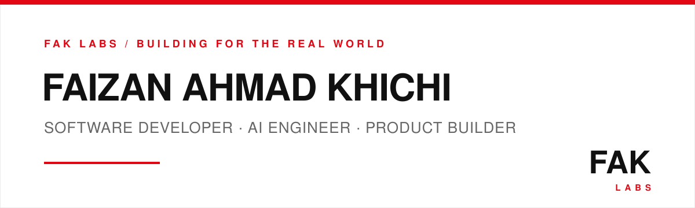
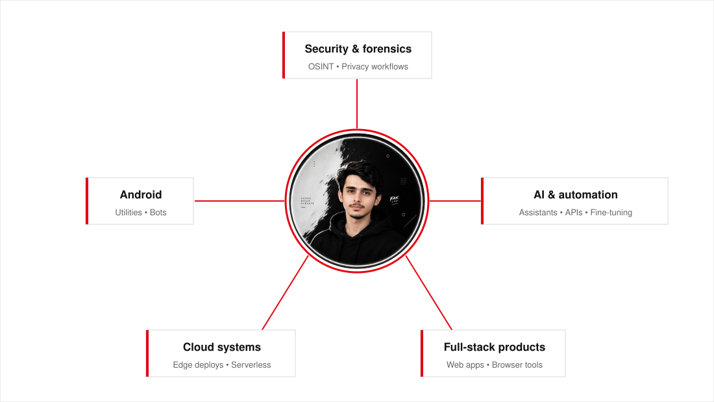
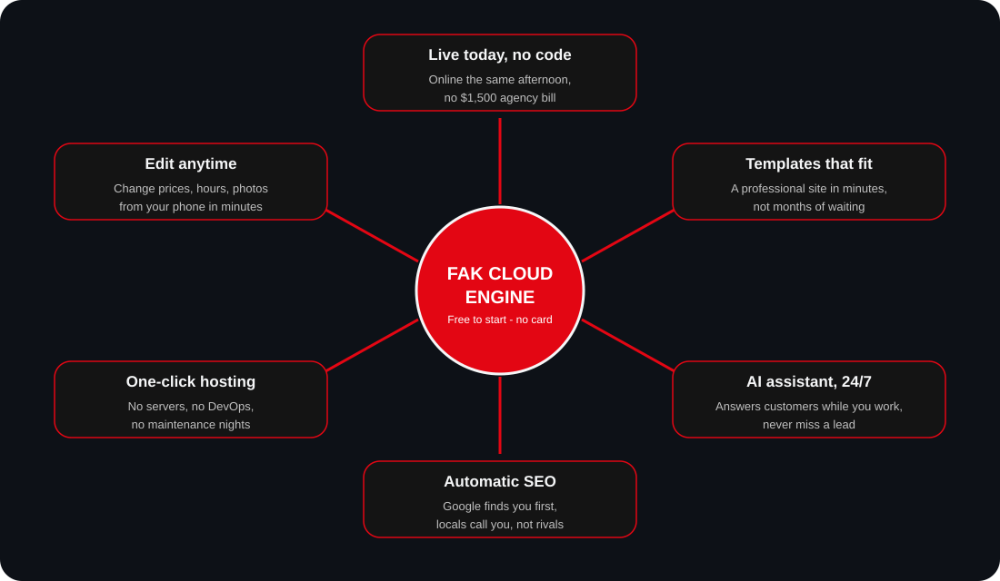
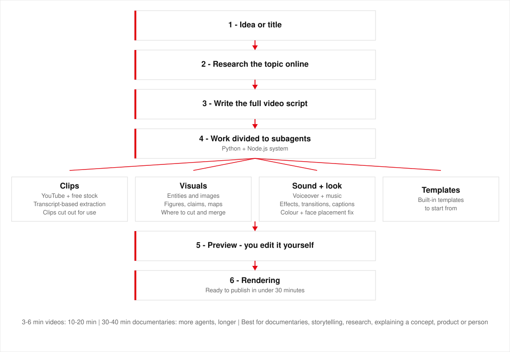
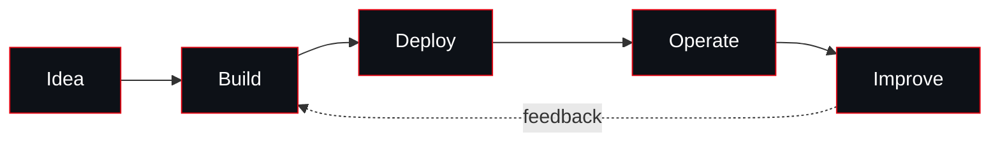

---

## At a glance

| | |
| --- | --- |
| **108** | free browser tools on FAK LAB |
| **10** | live products you can try below |
| **1** | studio — FAK LABS, founded October 2024, built and operated end-to-end |
| **0** | demos that never shipped — every flagship below has a live link |

## About me

I'm Faizan Ahmad Khichi, a software developer and AI engineer from Pakistan and the founder of **FAK LABS**, an independent software studio. I independently design, build, deploy and operate production software across **AI, automation, cybersecurity, mobile, cloud infrastructure and the modern web** — my production repositories are mostly private, so this profile focuses on public products you can evaluate directly.

- 🔭 **Currently:** building **VistaClip AI** (quality-controlled AI video production), researching **AI Shayri** (Urdu poetry language adaptation with Qwen3 LoRA fine-tuning), operating **FAK LAB** (108 free browser tools) and **FAK Cloud** (multi-tenant website hosting), and shipping **APEX as a native desktop app** (PyQt6, site parity as the floor, system control on top)
- 🌱 **Learning:** deepening LLM fine-tuning and GPU inference work through active R&D
- 🎯 **Goals:** ship VistaClip AI publicly, grow FAK LAB's global reach, and take on a remote software engineering role
- 📫 **Reach me:** [LinkedIn](https://www.linkedin.com/in/faklabs/) (fastest) or [Fiverr](https://www.fiverr.com/faklabs) for project work
- ⚡ **Fun fact:** I'm a self-taught developer — everything on this profile was learned by building and shipping
- 👤 **About:** 18 years old, based in Lahore District, Punjab, Pakistan; Founder & CEO of FAK LABS since October 2024; speaks English, Urdu, Punjabi and Hindi; attended Punjab College Sheikhupura

## What I build

## Featured products — try them live

| Product | What it does | Try it |
| --- | --- | --- |
| **FAK LAB** | Security, OSINT, developer, image, document and everyday browser tools | [Open platform →](https://faizankhichi.me/) |
| **FAK LAB MUSIC** | Cloud-powered music discovery and streaming | [Listen now →](https://music.faizankhichi.me/) |
| **Islamic Portal** | Quran, Hadith, prayer times, duas and daily resources | [Visit portal →](https://quran.fakcloud.tech/) |
| **Poster Maker Pro** | A browser-based visual design and poster workspace | [Start designing →](https://faizankhichi.me/poster/) |
| **AllDL** | Public-media download workflows across supported platforms | [Open AllDL →](https://alldl.faizankhichi.me/) |

## FAK Cloud Engine — how a business benefits

[FAK Cloud Engine](https://engine.fakcloud.tech/) is the no-code hosting and AI website builder behind FAK Cloud. A local business does not buy features — it gets customers, without an agency bill, servers, or waiting months.

Plus: a Telegram bot builder (shop, seller, support and AI chat templates, hosted for you, no server to manage), and pricing that starts free — $0, then $12/month Starter or $29/month Business only when it pays. For plumbers, salons, clinics, restaurants, schools, freelancers and agencies.

[Try FAK Cloud Engine →](https://engine.fakcloud.tech/)

## APEX — desktop voice assistant

**APEX** is my desktop voice assistant with a custom "Hey Neo" wake word, a live particle humanoid face, and hand-gesture control (open palm to follow, fist to grab, pinch to click, wrist roll to spin). The interactive humanoid runs at [apex.faizankhichi.me](https://apex.faizankhichi.me/).

Also live from FAK LABS: Passport Photo Maker (AI passport photos, 300-DPI export and print sheets), STL Maker (image-to-3D-printable relief), [Sound Effects](https://sounds-effects.fakcloud.tech/) (free sound effects library), and [FAK BOT](https://faklabbot.fakcloud.tech/) — full list on the [portfolio](https://portfolio.faizankhichi.me/).

Selected client work in the same period — portfolio upgrades for SEO, proper hosting, and custom domains — is kept off this profile by name, by design: the work speaks, the client list does not.

## Flagship private product

### VistaClip AI — intelligent video creation and editing

VistaClip AI turns an idea into a structured, editable video project through a quality-controlled AI workflow. It combines script development, voice generation, verified media selection, captions, timeline composition, preview and server rendering across landscape, portrait, square and classic formats.

The production source remains private, but the engineering decisions, release evidence and product capabilities are documented in a public case study.

How it works, in your words: a multi-step agent that takes an idea or title, researches the topic online, writes the full script, then splits the work to subagents — clips from YouTube and free stock providers, extracted by transcript and cut for use; entities and images for the video; voice and video effects, transitions and captions; visuals for figures, claims and maps, with cut and merge decisions; voiceover, background music, colour correction, and face-placement fixes when a stock photo puts a face in the wrong place. Built-in templates to start from, a preview you edit yourself before rendering, in Python and Node.js. A full ready-to-publish video in under 30 minutes: 3–6 minute videos take 10–20 minutes, 30–40 minute documentaries take more agents and longer. Built for documentaries, storytelling, research, and explaining any concept, product or person.

[**Read the VistaClip AI case study →**](case-studies/vistaclip-ai.md) · [**Discuss a similar project →**](https://www.linkedin.com/in/faklabs/) · [**Hire me →**](https://www.fiverr.com/faklabs)

### Current AI research & development

**AI Shayri by FAK** is an active private R&D project for Urdu poetry language adaptation. The current work includes a provenance-preserving classical Urdu dataset, deterministic train/validation/test splits, dataset validation, poem-preserving training chunks and a Qwen3-0.6B LoRA pilot. The next stage focuses on controlled generation by theme, poetic form, rhyme, refrain and length.

My wider applied-AI experience includes lightweight model training, task-focused chatbot fine-tuning, generative-media workflows and deploying open-source inference workloads as APIs on GPU infrastructure.

### Engineering case studies

Source code for production systems remains private, but these public briefs document the product thinking, capabilities and engineering considerations behind selected releases.

- [FAK LAB — building a discoverable platform for 90+ browser tools](case-studies/fak-lab.md)
- [VistaClip AI — building a quality-controlled AI video production system](case-studies/vistaclip-ai.md)
- [AllDL — designing a resilient multi-provider media workflow](case-studies/alldl.md)
- [Poster Maker Pro — creating a responsive browser design workspace](case-studies/poster-maker-pro.md)

## Technology toolkit

### Languages

### Web, AI & cloud

## How I work

- Build assets, not just hours: products and APIs that keep working for users after they ship
- Own the complete journey from product idea and interface to deployment
- Design for phones, limited bandwidth and real-world operating conditions
- Keep private systems private while making public work easy to evaluate
- Say less, ship more: one clear flagship per category, no inflated counts or borrowed claims
- Improve through testing, feedback and measurable use

---

### Have an idea worth building?

[**See my work**](https://portfolio.faizankhichi.me/) · [**Connect on LinkedIn**](https://www.linkedin.com/in/faklabs/) · [**Hire me on Fiverr**](https://www.fiverr.com/faklabs) · [**Explore FAK LABS**](https://github.com/FAK-LABS)

*Building useful technology from Pakistan for the world.*

